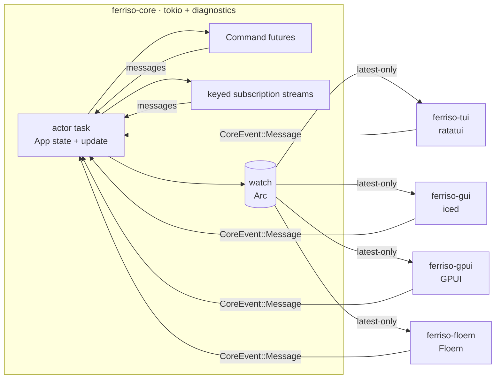

# Ferriso

One actor-owned application, two production frontends: **ratatui** in the
terminal and **iced** on the desktop, with **Tokio** as the runtime underneath.
**GPUI** and **Floem** are boundary probes that test whether the same contract
survives a third rendering paradigm; they are not equal-priority frontends.



The core is the only owner of domain state. A frontend receives immutable view
snapshots and sends semantic messages; it never calls `update`, never borrows the
application, and never shares a widget tree with another frontend.

## Crates

| Crate | Role | Dependencies |
| --- | --- | --- |
| `ferriso-diagnostics` | Error contract, pluggable logger, debug switch, bounded event/error rings, report export | `thiserror`, `miette` |
| `ferriso-keymap` | Frontend-neutral key chords, binding parser, and shortcut maps shared by TUI and GUI adapters | std |
| `ferriso-workspace` | Frontend-neutral `Tabs`, `SplitPane`, and `TableState` models; no renderer dependency | std |
| `ferriso-core` | Actor runtime, `App` contract, `Command`, bounded command inbox, keyed subscriptions, snapshot channel, lifecycle panic boundaries | `ferriso-diagnostics`, futures, Tokio |
| `ferriso-config` | One-stop layered TOML/environment loading over `config-rs`; actionable errors and source listing | `config`, serde, `thiserror`, `miette` |
| `ferriso-platform` | Native services behind injectable traits: opener, UTF-8 clipboard, notifications, file dialogs, and normalized file watching | opener: std; other services opt in per feature |
| `ferriso-test` | Headless actor harness: send messages, wait for view predicates, and clean shutdown | `ferriso-core` |
| `ferriso-tracing` | `tracing` backend for diagnostics records; subscriber/OTel layers remain caller-owned | `ferriso-diagnostics`, `tracing` |
| `ferriso-tui` | Terminal loop, crossterm translation, ratatui layout | `ferriso-core`, `ferriso-keymap`, ratatui, crossterm, futures, Tokio runtime |
| `ferriso-gui` | Iced adapter: snapshot-driven `State`, subscriptions, window, diagnostics-aware run path | `ferriso-core`, `ferriso-keymap`, iced, futures |
| `ferriso-gpui` | GPUI adapter: entity-rendered snapshots, background-to-foreground bridge, window lifecycle | `ferriso-core`, GPUI, futures |
| `ferriso-floem` | Floem adapter: snapshot signal, reactive native views, window lifecycle | `ferriso-core`, Floem, crossbeam |
| `ferriso-editor` | GUI-independent editor core: gap buffer, grapheme/visual coordinates, undo transactions, incremental LSH highlighting | `lsh`, `unicode-segmentation`, `unicode-width` |
| `lsh` | Vendored MIT LSH bytecode runtime and generated language definitions from `microsoft/edit` | std |
| `apps/ferriso-cli` | Clawless-based `ferriso` command: framework version, crate/app catalog, and toolchain doctor | `clawless`, serde |
| `apps/player` | Practice app: one model + view model, independent terminal and iced views | core, config, keymap, tui, iced |
| `apps/data-workbench` | 100k-row Modrinth-like project catalog dogfooding the shared table model in terminal and iced views | core, workspace, tui, gui |
| `apps/terminal` | Embedded terminal prototype: `rio-vt` PTY/grid with an iced cell renderer and window adaptation | core, gui, `rio-vt` |
| `apps/yazi-desktop` | File manager proving the contract with layered config, terminal list/preview, orbit canvas, aurora shader, debug overlay | core, config, platform, gui, tui, diagnostics |
| `apps/editor` | Tabbed editor over one actor-owned model: native iced canvas and ratatui views, soft wrap, search/replace, IME preedit, save guards, syntax highlighting | core, editor, gui, tui, platform |
| `apps/twozero48` | Animated GUI-only 2048 probe using the upstream `twozero48` board rules | core, gui, keymap, `twozero48`, `rand` |

The research notes behind the adapter choices are in
[`docs/ecosystem-study.md`](docs/ecosystem-study.md).

The dependency boundary is explicit: the core depends on Tokio and the
diagnostics contract, not on a database, a logger backend, or a UI toolkit.
`ferriso-diagnostics` links no backend; applications choose one (`tracing`,
`log`, syslog, stderr, a test buffer). Frontend-neutral models live in
`ferriso-workspace`, so TUI and headless consumers do not link iced.

`ferriso-platform` follows the same rule for native services. The package's
default features keep all four backends enabled for standalone use; workspace
consumers opt in explicitly. `apps/editor` enables `clipboard` and `dialogs`;
`apps/yazi-desktop` enables neither and pays only for the standard-library
opener.

File dialogs keep the object-safe synchronous `FileDialog` trait for test
doubles and simple callers. Async applications use `pick_file_async`,
`pick_folder_async`, or `save_file_async`; these run the backend on Tokio's
blocking pool so an open/save dialog cannot stall actor updates. Cancellation is
`Ok(None)`. `DialogError` reports a failed blocking worker only, because `rfd`
does not expose backend errors.

## Core contract

```rust
use std::{future::Future, pin::Pin};

pub trait App: Send + 'static {
    type Message: Send + 'static;
    type View: Send + Sync + 'static;

    fn init(&mut self) -> Command<Self::Message> { Command::none() }
    fn update(&mut self, message: Self::Message) -> Command<Self::Message>;
    fn view(&self) -> Self::View;

    fn subscriptions(&self) -> Subscription<Self::Message> { Subscription::none() }
    fn should_quit(&self) -> bool { false }
    fn shutdown_async(&mut self) -> Option<Pin<Box<dyn Future<Output = ()> + Send + '_>>> { None }
    fn shutdown(&mut self) {}
    fn debug(&self, _message: &Self::Message) -> Option<String> { None }
}
```

Rules that keep the boundary real:

- `Message` is semantic. It contains no `crossterm::event::KeyEvent`, no
  `iced::keyboard::Event`, no widget or layout type. Each frontend maps raw input
  onto the application's messages.
- `View` is data, not a widget tree. The terminal and the window are free to lay
  out the same data differently.
- Commands are futures executed on the actor's Tokio runtime. Their results come
  back as ordinary messages, so all mutation still happens in one task. The
  command/subscription inbox is bounded at 256; full producers wait for capacity
  instead of growing memory without limit. In-flight command tasks are aborted
  on shutdown.
- Selective cancellation is cooperative: keep a `CancellationToken` in app
  state, clone it into the command future, and cancel it when the work becomes
  stale. The application decides which work stops; unkeyed command futures are
  never aborted behind the application's back except at actor shutdown.
- Latest-wins commands use `Command::perform_keyed(key, future, map)`. The
  actor keeps at most one in-flight command per key; dispatching a new command
  with the same key aborts the previous future without emitting a message.
  Already-delivered results are ordinary messages and are not retracted. Use
  this for search-as-you-type; do not use it for writes or installations that
  must finish after the UI moves on.
- Subscriptions are long-lived streams declared by `App::subscriptions` and
  keyed by a stable `u64`. The actor reconciles them after `init` and every
  update: new keys are spawned, missing keys are aborted, and existing keys
  keep running. Change the key when stream parameters change. A stream that
  ends stays registered under its key until the application stops returning
  it; use `Subscription::interval` for clocks,
  `Subscription::stream_with_end` when completion must be observed, and
  commands for one-shot work.
- Snapshots are delivered over a `tokio::sync::watch` channel. A slow frontend
  gets the newest state instead of a backlog.

### Snapshot hooks

Every adapter treats the boot snapshot like any later snapshot:

- `ferriso-gui` calls `Renderer::on_snapshot_task` for the snapshot read at
  window boot and for every snapshot delivered by the actor. The default
  implementation forwards to `on_snapshot` and returns `Task::none()`, so
  bookkeeping hooks keep working. Override it when snapshot handling must focus
  a widget or schedule renderer-local work.
- `ferriso-tui` calls `Renderer::on_snapshot` once before the first draw and
  then whenever the actor publishes a different snapshot. Cache invalidation
  and notification diffing belong there instead of being duplicated in
  `draw` and `handle`. After that hook it calls `on_snapshot_message`; layouts
  whose height depends on snapshot state (for example an open search bar) return
  one optional semantic message from there, usually a new viewport. The default
  returns `None`.
- `ferriso-gpui` calls `Renderer::on_snapshot` for the boot snapshot.
- `ferriso-floem` calls `Renderer::on_snapshot` while constructing the initial
  signal value and for later values.

## Keyboard shortcuts

`ferriso-keymap` is the shared shortcut layer. Applications own their message
enum and a `Keymap<Message>`; adapters only translate platform events into
`ferriso_keymap::Chord` values. This keeps TUI and desktop shortcuts from
drifting while leaving text input, focus, and modal editing in the application.

```rust
use ferriso_keymap::Keymap;

let mut keys = Keymap::new();
keys.bind_str("Ctrl+Shift+P", Message::Palette)?;
keys.bind_str("Ctrl+S", Message::Save)?;

// Inside an adapter event loop:
let chord = ferriso_gui::keymap::chord(&key, modifiers)?;
let message = keys.resolve(&chord).cloned();
```

`ferriso-tui::keymap::chord` provides the Crossterm equivalent. Plain character
shortcuts are case-insensitive when Shift is the only modifier; chords with
explicit modifiers match exactly. The player and 2048 probes both use the
shared map, and adapter crates test the conversion boundary. The current layer
binds one chord per action; modal prefixes and multi-key sequences stay in the
application until a second consumer needs them.

## Running a frontend

```rust
// Convenience: the adapter owns a private runtime, actor, and terminal/window.
ferriso_tui::run(Player::new(), PlayerTui::new(), Options::default())?;
ferriso_gui::run(Player::new(), PlayerGui::new(), Settings::default())?;

// Tune the bounded command/subscription inbox.
let options = ferriso_core::RuntimeOptions::new(
    std::num::NonZeroUsize::new(64).expect("non-zero"),
);
let (handle, snapshots, task) = ferriso_core::spawn_with_options(Player::new(), options);

// Caller-owned diagnostics are available to both adapter paths.
let diagnostics = ferriso_core::Diagnostics::new().with_debug(true);
ferriso_tui::run_with_app_diagnostics(
    || Player::new(),
    PlayerTui::new(),
    Options::default(),
    diagnostics.clone(),
)?;

// When construction needs a reactor (HTTP clients, audio devices, tokio::spawn),
// build the app inside the adapter's runtime instead.
ferriso_gui::run_with_app(
    || Player::new(),
    PlayerGui::new(),
    Settings::default(),
)?;
```

One actor can serve several frontends:

```rust
let (handle, snapshots, task) = ferriso_core::spawn(Player::new());

let tui = std::thread::spawn({
    let handle = handle.clone();
    let snapshots = snapshots.clone();
    move || ferriso_tui::run_with(handle, snapshots, PlayerTui::new(), Options::default())
});

ferriso_gui::run_with(handle.clone(), snapshots, PlayerGui::new(), Settings::default())?;
handle.shutdown();
```

`run` (not `run_with`) is the single-frontend convenience: it shuts the actor
down and joins it when the UI exits. `run_with` deliberately leaves lifecycle
ownership with the caller.

## Diagnostics

Diagnostics are a framework facility, not `println!` calls in application code.
`ferriso-diagnostics` provides four layers:

| Layer | Contract |
| --- | --- |
| Error types | Concrete enums derive `thiserror::Error` (cause preserved) and `miette::Diagnostic` (stable code, help text, severity). `anyhow::Context` is used at executable boundaries. |
| Logger | `Logger` trait + `Level` + structured `Record` (target, phase, task id, context). The framework ships no backend requirement; `StderrLogger` is only an opt-in example. |
| Debug mode | `Diagnostics::new()` is quiet. `with_debug(true)` enables events and `Info`/`Debug`/`Trace` logs; `Warn`/`Error` remain eligible. |
| Report | Bounded event and error rings, task ids, safe environment facts, config summary, and `export()` for a one-file bundle. |

Runtime boundary capture:

- `init`, `update`, `view`, `subscriptions`, `should_quit`, and
  `shutdown` are wrapped with `catch_unwind` and phase/task context. A panic
  stops the actor instead of continuing on inconsistent state; startup panics
  are logged and re-raised, and a `shutdown` panic is recorded after the actor
  has already stopped. `App::debug` is diagnostic-only: its panic is logged and
  ignored. Each command future and subscription stream gets its own task id.
- These boundaries require Rust's default `panic = "unwind"`. A consumer
  release profile that sets `panic = "abort"` bypasses the diagnostics record
  and aborts the process; do that only when the panic report is expendable.
- Command futures are wrapped per future. A panicking command is recorded as
  `ferriso::command::panic`; its result is dropped and the actor stops rather
  than continuing on inconsistent state.
- Each subscription stream is wrapped separately. A panicking stream is recorded
  as `ferriso::subscription::panic`; that stream stops and the actor stops.
- A stream that returns `None` is recorded as a `subscription` debug event. Its key
  stays active until the application stops returning it; use
  `Subscription::stream_with_end` to receive a terminal message.

Config failures derive their own actionable error:

```text
[ferriso::config::invalid] configuration is invalid; searched: user=/… (optional, missing), local=./yazi-desktop.toml (present)
  help: Remove or rename the key named in the error. Unknown keys are rejected so typos cannot be silently ignored.
  caused by: unknown field `stray`, expected `value`
```

Run the minimal end-to-end example:

```bash
cargo run -p ferriso-diagnostics --example doctor
```

`yazi-desktop` consumes the same mechanism: `[debug] enabled = true` turns on
capture, `overlay = true` opens the event panel, and `stderr = true` installs the
stderr logger. `Ctrl+D` toggles the event panel; the panel's **Export** button
and `Ctrl+Shift+D` write a report to `$XDG_STATE_HOME/yazi-desktop/` (or
`~/.local/state/yazi-desktop/`).

## Configuration

Applications build a typed config through `ferriso-config`, a thin layer over
[`config-rs`](https://github.com/rust-cli/config-rs). Configuration is not a
core dependency, and the application decides which values reach the model and
the adapters. `yazi-desktop` uses `app = "yazi-desktop"`, so its files and
environment are namespaced independently:

- user file: `$XDG_CONFIG_HOME/yazi-desktop/config.toml`
- local file: `./yazi-desktop.toml`
- explicit file: `$YAZI_DESKTOP_CONFIG`
- environment: `YAZI_DESKTOP__DEBUG__OVERLAY=true`

The loader reports every candidate layer (path and present/missing state) for
diagnostics; values are never copied into a report. Missing optional layers are
skipped; a missing explicit layer or an unknown key fails with a code and a fix.
Use `Loader::load_with_sources` when the application reports provenance: it
returns the typed value and the exact source list from one load instead of
requiring a separate `sources()` call.

Sources are merged lowest to highest:

| Layer | Source |
| --- | --- |
| 1 | Serde defaults in `apps/player/src/config.rs` |
| 2 | System file: `/etc/ferriso/config.toml`, `/Library/Application Support/ferriso/config.toml` on macOS, `%PROGRAMDATA%\ferriso\config.toml` on Windows |
| 3 | User file: `$XDG_CONFIG_HOME/ferriso/config.toml`, else `~/.config/ferriso/config.toml` (`%APPDATA%` on Windows) |
| 4 | Project file: `./ferriso.toml` |
| 5 | Explicit file: `$FERRISO_CONFIG` (must exist) |
| 6 | Environment: `FERRISO__<SECTION>__<KEY>` |

Missing optional files are skipped. A missing `$FERRISO_CONFIG` is an error, so a
typo cannot silently fall back to defaults. The committed `ferriso.toml`
documents the full schema and is just the project-local layer:

```toml
[player]
volume = 0.7       # initial volume, clamped to 0.0..=1.0
tick_ms = 100      # playback tick (application timer)

[tui]
mouse = false
poll_ms = 50

[gui]
title = "Ferriso · music"
width = 1100.0
height = 760.0
```

Environment variables win over every file:

```bash
FERRISO__PLAYER__VOLUME=0.25 FERRISO__GUI__WIDTH=1400 \
  cargo run -p ferriso-player --bin ferriso-player-tui
```

Values loaded from files or the environment are normalized before they reach an
adapter: volume and window extents are clamped, `tick_ms`/`poll_ms` never reach
zero (which would busy-loop the terminal loop), and an empty title falls back to
the default. Unknown keys are rejected, so `volum = 0.5` is a startup error
instead of a silently ignored typo.

## KDE Plasma and Wayland

`ferriso-gui` builds on iced/winit, which selects Wayland when the session
offers it and falls back to X11 otherwise; no environment switch is required.
Fractional scaling (`wp_fractional_scale_v1`) and Wayland server-side
decorations are handled by winit, so KWin draws the title bar and scales the
window natively.

What a toolkit cannot infer is the application identity. The adapter sets a
stable id (`ferriso_gui::APPLICATION_ID`), which becomes
`xdg_toplevel.set_app_id` on Wayland and `WM_CLASS` on X11. KDE Plasma matches
that id against a desktop file to pick the taskbar icon, group windows, and
apply per-application rules. Install the matching entry once:

```bash
install -Dm644 packaging/io.github.gblmx.ferriso.desktop \
  ~/.local/share/applications/io.github.gblmx.ferriso.desktop
install -Dm644 packaging/io.github.gblmx.ferriso.svg \
  ~/.local/share/icons/hicolor/scalable/apps/io.github.gblmx.ferriso.svg

install -Dm644 packaging/io.github.gblmx.yazi-desktop.desktop \
  ~/.local/share/applications/io.github.gblmx.yazi-desktop.desktop
install -Dm644 packaging/io.github.gblmx.yazi-desktop.svg \
  ~/.local/share/icons/hicolor/scalable/apps/io.github.gblmx.yazi-desktop.svg
kbuildsycoca6 --noincremental
```

`yazi-desktop` uses the id `io.github.gblmx.yazi-desktop` for the same reason;
its desktop file and icon live next to the player's. Point `Exec=` at
`target/debug/yazi-desktop` when running from a checkout.

`Exec=` assumes `ferriso-player-gui` is on `PATH`; point it at the built binary
otherwise. The desktop file, icon name, `StartupWMClass`, and
`APPLICATION_ID` must keep the same value — that is what lets KWin associate the
Wayland surface with the entry.

## What iced owns, and what it does not

Iced owns its window, renderer, widget tree, focus, text cursor, scrolling, and
redraw scheduling. Those are frontend-local state and are not part of the
application model. Renderer-local messages (a seek preview, a key chord that
needs local state) travel through `Message::Local` and never wake the actor;
`on_snapshot` and `on_message` are the hooks for cover caches, QR codes, and
notifications, and `theme` lets each snapshot choose the window palette.

Iced **does not** own the application:

```text
boot:      Frontend { view: Arc<View>, handle: CoreHandle<Message>, renderer }
update:    User(message)   -> handle.send(message)   // no App::update here
           Snapshot(view)  -> replace the Arc        // read-only projection
           Closed          -> close the window
view:      renderer.view(&frontend.view)             // native iced layout
```

There is no `Mutex<App>` in the iced state. Recreating a window resumes from the
latest snapshot; it cannot fork the domain state. The subscription turns the
watch receiver into a stream, so iced receives changes without polling.

The same inversion holds for ratatui: the adapter owns the blocking loop, reads
the latest snapshot before drawing, and translates terminal events into
messages. It redraws only after an input event or a snapshot change, so an idle
terminal is not repainted twenty times a second. `Renderer::draw` receives `&View`; there is no mutable access to the
application.

## Why there is no shared layout IR in v1

The first prototype used a shared semantic widget tree (`Node` with `Row`,
`Column`, `Length`, padding, and callbacks) rendered by every frontend. It worked,
but it forced one layout model onto four very different UI toolkits and made the
core know about presentation. It is preserved on the `node-ir-prototype` branch
for comparison, not used here.

This version deliberately stops at the **view data model**. Terminal, iced, GPUI,
and Floem views are written separately, with native layout, because that is the
honest cost of native UI. Once boxpigma (a same-author downstream fork) and
Modrinth (a real application) both run on this contract, duplicated
*semantic components* can be extracted with evidence. A shared layout engine
before that would be speculative abstraction.

## Snapshot and event semantics

- Frontend input is intentionally unbounded and non-blocking: `CoreHandle::send`
  never waits for a frame or for the actor to finish work. Frontends own input
  coalescing; merge high-frequency mouse-move, resize, scroll, and text events
  before sending. Message queue size is not a runtime guarantee.
- Messages are small and semantic; each message is applied exactly once on the
  actor task. `CoreHandle::send` returns `false` only when the actor has stopped.
- The internal command/subscription result inbox is bounded. A full inbox
  backpressures producers; the actor never blocks a frontend send on UI work.
- Snapshots are `Arc<View>`; handing one to a frontend is a refcount bump.
- `Snapshots::revision` starts at `0` for boot and increments on every publish.
  The view value is not compared for equality, so a revision does not imply a
  different value. `changed_with_revision` returns both atomically.
- `watch` coalesces updates: if ten commands finish before a frame, the frontend
  sees the final state and the newest revision. Revisions may therefore skip for
  a slow reader.
- In-flight command tasks and active subscription keys are application-owned and
  are not silently capped. Bound fan-out in the application when a command or
  subscription can produce unbounded work.
- In-flight command tasks and active subscriptions are aborted on shutdown, then
  `App::shutdown_async` may flush, then `App::shutdown` performs synchronous
  cleanup. The runtime does not impose a shutdown deadline; the built-in
  adapter-owned `run` paths wait up to one second for the actor task before
  returning.
- Dropping every `CoreHandle` stops the actor. The TUI notices the closed
  snapshot channel and exits; iced receives `Closed` and closes the window.

## Adapters

Every adapter is a separate crate and owns only toolkit state. The core never
links ratatui, iced, GPUI, Floem, or a window system.

| Adapter | Snapshot mechanism | Renderer contract |
| --- | --- | --- |
| `ferriso-tui` | blocking snapshot receive inside the terminal loop | ratatui frame |
| `ferriso-gui` | iced subscription over the snapshot stream | `Renderer::view` |
| `ferriso-gpui` | background relay into a GPUI entity, `cx.notify()` | `Renderer::render` |
| `ferriso-floem` | crossbeam relay into a Floem signal and `dyn_container` | `Renderer::view` |

GPUI and Floem renderers receive a `Ui` sender, not the domain state or a core
handle abstraction owned by the toolkit. Both adapters keep widget-local state
in the toolkit (GPUI entity state, Floem signals) and rebuild their native view
from the latest immutable snapshot.

```bash
cargo run -p ferriso-floem --example floem-counter
cargo run -p ferriso-gpui --example gpui-counter
```

`run` owns an actor for the lifetime of the window. `run_with` attaches a window
to an actor owned elsewhere; the adapter stops its snapshot relay when the window
closes, leaving actor lifecycle with the caller.

## Twozero48 GUI probe

`apps/twozero48` is a small GUI-only probe built on the same Ferriso core and
iced adapter. The board rules and tile type come from the upstream
[`twozero48`](https://github.com/de-sh/twozero48) crate; the actor owns the
board, score, status, and RNG, and the renderer sees only a `View` with
animation hints: the last accepted move, a move sequence, and newly spawned
cells. The iced renderer uses those hints plus the previous snapshot to slide
tiles from their source cells, bounce merges, pulse the score, and pop new
tiles. Motion runs on iced frame ticks and stops as soon as the effect settles.

```bash
cargo run -p ferriso-twozero48 --bin twozero48-gui
```

Use the on-screen buttons, arrow keys, WASD, or `R` to restart. This app has no
TUI binary by design, so it is a GUI probe rather than a compatibility-matrix
entry.

## The practice app

`apps/player` exercises the contract with a music-player shell: sidebar
navigation, search, lists, lyrics, QR login (simulated), player controls,
progress, volume, and a spectrum.

```bash
cargo run -p ferriso-player --bin ferriso-player-tui
cargo run -p ferriso-player --bin ferriso-player-gui
```

Configuration for both binaries is layered; see [Configuration](#configuration).

Terminal keys: `Enter` play, `Tab` change focus, `Ctrl+Space` play/pause,
`Ctrl+←/→` previous/next, `Ctrl+M` mode, `Ctrl+L` like, `[`/`]` seek, `Ctrl+Q`
quit. In the window, the same state is driven by native buttons, sliders, and a
text input; `Ctrl+Space`, `Ctrl+←/→`, `Ctrl+M`, `Ctrl+L`, and `Ctrl+Q` are mapped
by the iced subscription.

The simulation never connects to a network or plays audio. Commands use
`tokio::time::sleep` to make asynchronous loading visible.

### yazi-desktop

`apps/yazi-desktop` is the second consumer: three-pane file manager, async
directory reads, an iced `pane_grid` preview pane, image and text previews, an
orbit composition chart, and the aurora backdrop. Drag the gap between the file
list and the preview to resize it; `Ctrl+P` hides or restores the preview. Image
previews decode on a blocking task at the pane's width with an 80 ms debounce,
a generation check for stale selections, one decode at a time, and a bounded
pixel cache, so large photos neither block the UI nor accumulate unbounded
handles or concurrent decodes. PDFs stay an
explicit placeholder. It has its own layered config and debug switches; see
[Diagnostics](#diagnostics). `apps/yazi-desktop/yazi-desktop.toml` is the full
schema with comments; copy it to `~/.config/yazi-desktop/config.toml` or keep it
as the project-local layer. Run it with:

```bash
# iced
cargo run -p ferriso-yazi-desktop

# terminal
cargo run -p ferriso-yazi-desktop --bin yazi-desktop-tui
```

The terminal frontend maps `j`/`k` or arrows to selection movement, `Enter`/`l`
to activate, `h`/`Left` to the parent, `Backspace` to history, `g` to home,
`/` to a live filter, `.` to hidden files, `r` to reload, and `q` to quit. Its
rows, preview text, stats, and selection come from the same `Yazi` actor; the
terminal does not decode images or duplicate directory state.

### Editor

`apps/editor` is a tabbed text editor with a GUI-independent
`ferriso-editor` kernel and one actor-owned `EditorModel`. Both a native iced
canvas and a ratatui terminal view render the same immutable snapshot; tabs,
search matches, dirty state, and save guards are core state, not frontend
state. It opens UTF-8 files, preserves BOM and LF/CRLF style, edits with
grapheme-aware cursor movement, renders tabs and wide characters, and supports
click/drag selection, mouse-wheel scrolling, clipboard, undo/redo, per-tab soft
wrap, and incremental LSH syntax highlighting. The lsh runtime and generated
definitions are vendored under `crates/lsh`; the compiler is not a build
dependency. Saves are staged through a same-directory temporary file and rename;
existing ordinary permission bits are preserved and new Unix files start as
`0600`. Atomic replacement changes the inode, so ownership, ACLs, xattrs, and
hard links are not preserved. The default `Document::open` path rejects files
above 64 MiB, and `open_with_limit` exposes an explicit bound.

The window is a real tabbed editor: tabs with dirty markers, a new-tab
button, an empty-buffer welcome screen, a search/replace bar, a status line with
caret position, language, line ending, and save state, and an unsaved-changes
confirmation before closing a tab or quitting. In iced, composition text is
drawn on-the-spot by the canvas and advertised to the input method. UTF-8, tabs,
wide characters, selections, and soft-wrapped rows all share the same visual
coordinate model in both frontends.

```bash
# iced
cargo run -p ferriso-editor-app --bin ferriso-editor -- /path/to/file.rs

# terminal
cargo run -p ferriso-editor-app --bin ferriso-editor-tui -- /path/to/file.rs
```

Keys:

| Chord | Action |
| --- | --- |
| `Ctrl+N` / `Ctrl+O` | new tab / open file |
| `Ctrl+S` / `Ctrl+Shift+S` | save / save as |
| `Ctrl+W` / `Ctrl+Tab` / `Ctrl+Shift+Tab` | close tab / next tab / previous tab |
| `Ctrl+Z` / `Ctrl+Y`, `Ctrl+Shift+Z` | undo / redo |
| `Ctrl+F` / `Ctrl+H` | find / find and replace |
| `F3` / `Shift+F3` | next / previous match |
| `Ctrl+H` with a query | focus the replacement field |
| `Alt+Z` | toggle soft wrap |
| `Ctrl+A`, `Ctrl+C`, `Ctrl+X`, `Ctrl+V` | select all, copy, cut, paste |
| `Ctrl+Q` | quit (asks before discarding changes) |

Arrow/Home/End/PageUp/PageDown move the caret; `Shift` extends the selection.
`Ctrl+Home`/`Ctrl+End` move to the start or end of the document. A new file can
be started with no path argument. Search is case-insensitive by default; `Aa`
switches to case-sensitive matching. `‹`/`›` and `REPLACE`/`ALL` are available
in the search bar; `Enter` in the query jumps to the next match, and `Esc`
closes the bar or the unsaved-changes dialog.

The terminal build is keyboard-only. While the find bar is open, `Tab` switches
between the query and replacement fields and `Up`/`Down` select matches. The
terminal has no `Aa` button; `F3`/`Shift+F3` cycle matches, and `Ctrl+Q` still
runs the same save guard as the window. `Ctrl+C` is ordinary copy in both
frontends; the adapter does not steal it for a hardcoded exit.

### Design gallery

`ferriso-gui` ships reusable artwork, skins, and interaction templates: the WGSL
aurora backdrop, animated pulse rings, the canvas orbit chart, live bar strips
and a progress gauge, renderer-local easing and timeline primitives, tokenized
surfaces and controls, a fuzzy command palette, a searchable combobox, and a
bounded toast stack. The design gallery combines the artwork, palette, and
toasts in one native window and switches between
Ferriso, YAZI, Windows 11, macOS, Windows 95, Mac OS Classic, CDE/Motif, and
Ember skins. Corner radius, border weight, bevels, surface opacity, and accent
contrast all change with the skin:

```bash
cargo run -p ferriso-gui --example design-gallery
```

`Ctrl+K` opens the palette, `↑`/`↓` move the selection, `Home`/`End` jump, and
`PageUp`/`PageDown` move by a page; `Enter` activates and `Esc` dismisses. A
scattered query such as `srf` still finds “Run surface audit”. Use the `STYLE`
row to switch skins. The buttons demonstrate solid, soft, and ghost treatments;
the notifications demonstrate success and warning toasts. A pulse timeline
drives the beacon rings; the bar strip, gauge, aurora, and orbit use the
renderer-local clock and never wake the core actor. The art and interaction
rationale is in
[`docs/art-interaction-study.md`](docs/art-interaction-study.md).

### Workspace gallery

The workspace models cover the lifecycle that otherwise gets copied into every
editor or data tool:

```bash
cargo run -p ferriso-gui --example workspace-gallery
```

- `ferriso_workspace::Tabs<T>` repairs the active index when a tab closes.
- `ferriso_workspace::SplitPane<K>` keeps a two-pane split ratio usable and
  tracks focus.
- `ferriso_workspace::TableState` builds only the visible range of a
  10,000-row table, including selection and scroll clamping.

The crate has no toolkit dependency; a TUI or GPUI app can use the models
without linking iced.

`Ctrl+Tab`/`Ctrl+Shift+Tab` cycle tabs and `Ctrl+W` closes the active tab. The
gallery is a model demonstration: applications still render their own tab
chrome, pane contents, table columns, and stable row ids.

## Versioning and downstreams

The workspace shares one version. While the project is `0.x`, a minor bump may
break the contract; patches do not. The current line is `0.3.x`. Boxpigma is a
same-author downstream fork of pigma, pinned to `55d1745` (0.3.1), so it acts
as a controlled compatibility probe rather than independent adoption. See
[`docs/versioning.md`](docs/versioning.md) for the release and downstream
matrix.

## Framework CLI

`apps/ferriso-cli` is the Clawless-based `ferriso` command:

```bash
cargo run -p ferriso-cli -- --help
cargo run -p ferriso-cli -- version
cargo run -p ferriso-cli -- apps
cargo run -p ferriso-cli -- crates
cargo run -p ferriso-cli -- doctor
cargo run -p ferriso-cli -- --json apps
```

Clawless owns argument parsing, async command execution, and presentation. The
catalog commands emit structured artifacts, so `--json` is a stable machine
surface; `doctor` checks the local `rustc`/`cargo` against the workspace MSRV.

The app catalog includes the CLI itself, `data-workbench`, and `terminal`; the
`catalog_includes_the_new_apps` test guards against new apps being omitted.

## Tests

The application × frontend status and the exact smoke commands live in
[`docs/compatibility.md`](docs/compatibility.md). Run the headless matrix with:

```bash
./scripts/compat-check.sh
```

That script also runs `./scripts/architecture-check.sh`, which rejects renderer
dependencies in the core, TUI/iced cross-dependencies, and native service
dependencies in the feature-free platform crate.

```bash
cargo test --workspace
cargo clippy --workspace --all-targets -- -D warnings
```

- `ferriso-cli`: unique crate/app catalogs, frontend labels, and stable/nightly
  Rust version parsing for the doctor command.
- `ferriso-diagnostics`: error code/help/cause rendering, quiet-by-default
  behavior, bounded rings, logger filtering, report contents, and export.
- `ferriso-core`: command round trips, bounded-inbox bursts, command abort on
  shutdown, cooperative cancellation tokens, subscription
  delivery/cancellation/end reporting, snapshot revisions,
  async-shutdown ordering and panic containment, per-command task ids, shutdown
  when handles drop, debug event capture, and fatal user-task panic handling for
  updates, commands, and streams.
- `ferriso-config`: layer precedence, required explicit file, unknown-key help,
  preserved config source, and layer listing.
- `ferriso-platform`: typed opener errors, clipboard round trips, notification
  recording, dialog selection plus async blocking-pool helpers, normalized
  memory watch events, a real temp-file watch, and trait-object injection for
  services.
- `ferriso-test`: message delivery, view-predicate waits, actor-close handling,
  clean shutdown, harness-drop cleanup, and shared-actor TUI/iced conformance.
- `ferriso-tracing`: diagnostics levels and structured fields reach a scoped
  tracing subscriber.
- `ferriso-keymap`: binding parsing, display normalization, exact modifier
  matching, plain-character case folding, overrides, and error cases.
- `ferriso-gui`: design-token styles, platform skin geometry/bevels,
  command-palette fuzzy ranking, page/first/last navigation, toast expiry,
  bounding, dismissal, bar/gauge normalization, and iced-to-chord conversion.
- `ferriso-workspace`: tab close repair, split-ratio/focus clamping, and
  virtual-table scrolling/selection.
- `ferriso-tui`: Crossterm-to-chord conversion, including space normalization
  and rejected Hyper/Meta modifiers.
- `ferriso-gpui` and `ferriso-floem`: actor-to-UI snapshot relay and shutdown.
- `apps/player`: update and subscription-tick transitions, login as snapshot state, configuration
  normalization and adapter mapping, TUI rendering into a `TestBackend`, and
  terminal input translation (Enter, Tab, search editing).
- `apps/yazi-desktop`: listing/filter/navigation, config normalization, TUI
  snapshot rendering/key translation, image
  and text previews, preview-width clamping, pane layout, handle reuse, and
  diagnostics export content.
- `ferriso-editor`: gap-buffer randomized replacements, BOM/CRLF round trips,
  grapheme and tab widths, undo/redo save boundaries, soft-wrap widths and
  click targets, and LSH highlighting invalidation.
- `apps/editor`: case-sensitive/folded search byte offsets and replacement
  splicing.
- `apps/twozero48`: 2048 merges, score, restart, keymap shortcuts, spawn
  metadata, and slide/merge animation state.

The iced GUI, GPUI, and Floem adapters are exercised by running their binaries or
examples; they have no headless widget assertions because the native renderer is
the surface being tested.
