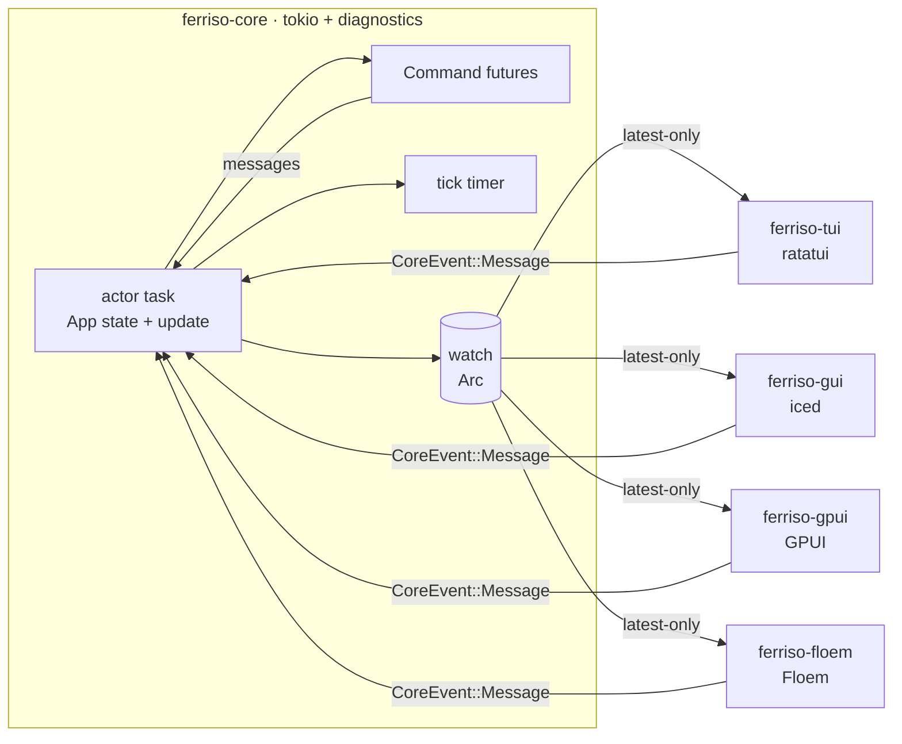

# Ferriso

One actor-owned application, four native frontends: **ratatui** in the terminal,
**iced** and **GPUI** on the desktop, and **Floem** for reactive native views,
with **Tokio** as the runtime underneath.



The core is the only owner of domain state. A frontend receives immutable view
snapshots and sends semantic messages; it never calls `update`, never borrows the
application, and never shares a widget tree with another frontend.

## Crates

| Crate | Role | Dependencies |
| --- | --- | --- |
| `ferriso-diagnostics` | Error contract, pluggable logger, debug switch, bounded event/error rings, report export | `thiserror`, `miette` |
| `ferriso-core` | Actor runtime, `App` contract, `Command`, snapshot channel, lifecycle panic boundaries | `ferriso-diagnostics`, futures, Tokio |
| `ferriso-config` | One-stop layered TOML/environment loading over `config-rs`; actionable errors and source listing | `config`, serde, `thiserror`, `miette` |
| `ferriso-tui` | Terminal loop, crossterm translation, ratatui layout | `ferriso-core`, ratatui, crossterm, Tokio runtime |
| `ferriso-gui` | Iced adapter: snapshot-driven `State`, subscriptions, window, diagnostics-aware run path | `ferriso-core`, iced, futures |
| `ferriso-gpui` | GPUI adapter: entity-rendered snapshots, background-to-foreground bridge, window lifecycle | `ferriso-core`, GPUI, futures |
| `ferriso-floem` | Floem adapter: snapshot signal, reactive native views, window lifecycle | `ferriso-core`, Floem, crossbeam |
| `apps/player` | Practice app: one model + view model, independent terminal and iced views | core, config, tui, iced |
| `apps/yazi-desktop` | File manager proving the contract with layered config, orbit canvas, aurora shader, debug overlay | core, config, gui, diagnostics |

The dependency boundary is explicit: the core depends on Tokio and the
diagnostics contract, not on a database, a logger backend, or a UI toolkit.
`ferriso-diagnostics` links no backend; applications choose one (`tracing`,
`log`, syslog, stderr, a test buffer).

## Core contract

```rust
pub trait App: Send + 'static {
    type Message: Send + 'static;
    type View: Send + Sync + 'static;

    fn init(&mut self) -> Command<Self::Message> { Command::none() }
    fn update(&mut self, message: Self::Message) -> Command<Self::Message>;
    fn view(&self) -> Self::View;

    fn tick_interval(&self) -> Option<Duration> { None }
    fn tick(&mut self) -> Command<Self::Message> { Command::none() }
    fn should_quit(&self) -> bool { false }
    fn shutdown(&mut self) {}
    fn debug(&self, _message: &Self::Message) -> Option<String> { None }
}
```

Rules that keep the boundary real:

- `Message` is semantic. It contains no `crossterm::event::KeyEvent`, no
  `iced::keyboard::Event`, no widget or layout type. Each frontend maps raw input
  onto the application's messages.
- `View` is data, not a widget tree. The terminal and the window are free to lay
  out the same data differently.
- Commands are futures executed on the actor's Tokio runtime. Their results come
  back as ordinary messages, so all mutation still happens in one task.
- The timer belongs to the actor. Frontends do not tick the application.
- Snapshots are delivered over a `tokio::sync::watch` channel. A slow frontend
  gets the newest state instead of a backlog.

### Snapshot hooks

Every adapter treats the boot snapshot like any later snapshot:

- `ferriso-gui` calls `Renderer::on_snapshot_task` for the snapshot read at
  window boot and for every snapshot delivered by the actor. The default
  implementation forwards to `on_snapshot` and returns `Task::none()`, so
  bookkeeping hooks keep working. Override it when snapshot handling must focus
  a widget or schedule renderer-local work.
- `ferriso-tui` calls `Renderer::on_snapshot` once before the first draw and
  then whenever the actor publishes a different snapshot. Cache invalidation
  and notification diffing belong there instead of being duplicated in
  `draw` and `handle`.
- `ferriso-gpui` calls `Renderer::on_snapshot` for the boot snapshot.
- `ferriso-floem` calls `Renderer::on_snapshot` while constructing the initial
  signal value and for later values.

## Running a frontend

```rust
// Convenience: the adapter owns a private runtime, actor, and terminal/window.
ferriso_tui::run(Player::new(), PlayerTui::new(), Options::default())?;
ferriso_gui::run(Player::new(), PlayerGui::new(), Settings::default())?;

// Caller-owned diagnostics are available to both adapter paths.
let diagnostics = ferriso_core::Diagnostics::new().with_debug(true);
ferriso_tui::run_with_app_diagnostics(
    || Player::new(),
    PlayerTui::new(),
    Options::default(),
    diagnostics.clone(),
)?;

// When construction needs a reactor (HTTP clients, audio devices, tokio::spawn),
// build the app inside the adapter's runtime instead.
ferriso_gui::run_with_app(
    || Player::new(),
    PlayerGui::new(),
    Settings::default(),
)?;
```

One actor can serve several frontends:

```rust
let (handle, snapshots, task) = ferriso_core::spawn(Player::new());

let tui = std::thread::spawn({
    let handle = handle.clone();
    let snapshots = snapshots.clone();
    move || ferriso_tui::run_with(handle, snapshots, PlayerTui::new(), Options::default())
});

ferriso_gui::run_with(handle.clone(), snapshots, PlayerGui::new(), Settings::default())?;
handle.shutdown();
```

`run` (not `run_with`) is the single-frontend convenience: it shuts the actor
down and joins it when the UI exits. `run_with` deliberately leaves lifecycle
ownership with the caller.

## Diagnostics

Diagnostics are a framework facility, not `println!` calls in application code.
`ferriso-diagnostics` provides four layers:

| Layer | Contract |
| --- | --- |
| Error types | Concrete enums derive `thiserror::Error` (cause preserved) and `miette::Diagnostic` (stable code, help text, severity). `anyhow::Context` is used at executable boundaries. |
| Logger | `Logger` trait + `Level` + structured `Record` (target, phase, task id, context). The framework ships no backend requirement; `StderrLogger` is only an opt-in example. |
| Debug mode | `Diagnostics::new()` is quiet. `with_debug(true)` enables events and `Info`/`Debug`/`Trace` logs; `Warn`/`Error` remain eligible. |
| Report | Bounded event and error rings, task ids, safe environment facts, config summary, and `export()` for a one-file bundle. |

Runtime boundary capture:

- `init`, `update`, `tick`, `view`, `should_quit`, `shutdown`, and `App::debug`
  are wrapped with `catch_unwind` and phase/task context. A panic stops the
  actor instead of continuing on inconsistent state; startup panics are logged
  and re-raised.
- These boundaries require Rust's default `panic = "unwind"`. A consumer
  release profile that sets `panic = "abort"` bypasses the diagnostics record
  and aborts the process; do that only when the panic report is expendable.
- Command futures are wrapped per future. A panicking command is recorded as
  `ferriso::command::panic`, its result is dropped, and the actor keeps running.

Config failures derive their own actionable error:

```text
[ferriso::config::invalid] configuration is invalid; searched: user=/… (optional, missing), local=./yazi-desktop.toml (present)
  help: Remove or rename the key named in the error. Unknown keys are rejected so typos cannot be silently ignored.
  caused by: unknown field `stray`, expected `value`
```

Run the minimal end-to-end example:

```bash
cargo run -p ferriso-diagnostics --example doctor
```

`yazi-desktop` consumes the same mechanism: `[debug] enabled = true` turns on
capture, `overlay = true` opens the event panel, and `stderr = true` installs the
stderr logger. `Ctrl+D` toggles the event panel; the panel's **Export** button
and `Ctrl+Shift+D` write a report to `$XDG_STATE_HOME/yazi-desktop/` (or
`~/.local/state/yazi-desktop/`).

## Configuration

Applications build a typed config through `ferriso-config`, a thin layer over
[`config-rs`](https://github.com/rust-cli/config-rs). Configuration is not a
core dependency, and the application decides which values reach the model and
the adapters. `yazi-desktop` uses `app = "yazi-desktop"`, so its files and
environment are namespaced independently:

- user file: `$XDG_CONFIG_HOME/yazi-desktop/config.toml`
- local file: `./yazi-desktop.toml`
- explicit file: `$YAZI_DESKTOP_CONFIG`
- environment: `YAZI_DESKTOP__DEBUG__OVERLAY=true`

The loader reports every candidate layer (path and present/missing state) for
diagnostics; values are never copied into a report. Missing optional layers are
skipped; a missing explicit layer or an unknown key fails with a code and a fix.
Use `Loader::load_with_sources` when the application reports provenance: it
returns the typed value and the exact source list from one load instead of
requiring a separate `sources()` call.

Sources are merged lowest to highest:

| Layer | Source |
| --- | --- |
| 1 | Serde defaults in `apps/player/src/config.rs` |
| 2 | System file: `/etc/ferriso/config.toml`, `/Library/Application Support/ferriso/config.toml` on macOS, `%PROGRAMDATA%\ferriso\config.toml` on Windows |
| 3 | User file: `$XDG_CONFIG_HOME/ferriso/config.toml`, else `~/.config/ferriso/config.toml` (`%APPDATA%` on Windows) |
| 4 | Project file: `./ferriso.toml` |
| 5 | Explicit file: `$FERRISO_CONFIG` (must exist) |
| 6 | Environment: `FERRISO__<SECTION>__<KEY>` |

Missing optional files are skipped. A missing `$FERRISO_CONFIG` is an error, so a
typo cannot silently fall back to defaults. The committed `ferriso.toml`
documents the full schema and is just the project-local layer:

```toml
[player]
volume = 0.7       # initial volume, clamped to 0.0..=1.0
tick_ms = 100      # actor and playback tick

[tui]
mouse = false
poll_ms = 50

[gui]
title = "Ferriso · music"
width = 1100.0
height = 760.0
```

Environment variables win over every file:

```bash
FERRISO__PLAYER__VOLUME=0.25 FERRISO__GUI__WIDTH=1400 \
  cargo run -p ferriso-player --bin ferriso-player-tui
```

Values loaded from files or the environment are normalized before they reach an
adapter: volume and window extents are clamped, `tick_ms`/`poll_ms` never reach
zero (which would busy-loop the terminal loop), and an empty title falls back to
the default. Unknown keys are rejected, so `volum = 0.5` is a startup error
instead of a silently ignored typo.

## KDE Plasma and Wayland

`ferriso-gui` builds on iced/winit, which selects Wayland when the session
offers it and falls back to X11 otherwise; no environment switch is required.
Fractional scaling (`wp_fractional_scale_v1`) and Wayland server-side
decorations are handled by winit, so KWin draws the title bar and scales the
window natively.

What a toolkit cannot infer is the application identity. The adapter sets a
stable id (`ferriso_gui::APPLICATION_ID`), which becomes
`xdg_toplevel.set_app_id` on Wayland and `WM_CLASS` on X11. KDE Plasma matches
that id against a desktop file to pick the taskbar icon, group windows, and
apply per-application rules. Install the matching entry once:

```bash
install -Dm644 packaging/io.github.gblmx.ferriso.desktop \
  ~/.local/share/applications/io.github.gblmx.ferriso.desktop
install -Dm644 packaging/io.github.gblmx.ferriso.svg \
  ~/.local/share/icons/hicolor/scalable/apps/io.github.gblmx.ferriso.svg

install -Dm644 packaging/io.github.gblmx.yazi-desktop.desktop \
  ~/.local/share/applications/io.github.gblmx.yazi-desktop.desktop
install -Dm644 packaging/io.github.gblmx.yazi-desktop.svg \
  ~/.local/share/icons/hicolor/scalable/apps/io.github.gblmx.yazi-desktop.svg
kbuildsycoca6 --noincremental
```

`yazi-desktop` uses the id `io.github.gblmx.yazi-desktop` for the same reason;
its desktop file and icon live next to the player's. Point `Exec=` at
`target/debug/yazi-desktop` when running from a checkout.

`Exec=` assumes `ferriso-player-gui` is on `PATH`; point it at the built binary
otherwise. The desktop file, icon name, `StartupWMClass`, and
`APPLICATION_ID` must keep the same value — that is what lets KWin associate the
Wayland surface with the entry.

## What iced owns, and what it does not

Iced owns its window, renderer, widget tree, focus, text cursor, scrolling, and
redraw scheduling. Those are frontend-local state and are not part of the
application model. Renderer-local messages (a seek preview, a key chord that
needs local state) travel through `Message::Local` and never wake the actor;
`on_snapshot` and `on_message` are the hooks for cover caches, QR codes, and
notifications, and `theme` lets each snapshot choose the window palette.

Iced **does not** own the application:

```text
boot:      Frontend { view: Arc<View>, handle: CoreHandle<Message>, renderer }
update:    User(message)   -> handle.send(message)   // no App::update here
           Snapshot(view)  -> replace the Arc        // read-only projection
           Closed          -> close the window
view:      renderer.view(&frontend.view)             // native iced layout
```

There is no `Mutex<App>` in the iced state. Recreating a window resumes from the
latest snapshot; it cannot fork the domain state. The subscription turns the
watch receiver into a stream, so iced receives changes without polling.

The same inversion holds for ratatui: the adapter owns the blocking loop, reads
the latest snapshot before drawing, and translates terminal events into
messages. It redraws only after an input event or a snapshot change, so an idle
terminal is not repainted twenty times a second. `Renderer::draw` receives `&View`; there is no mutable access to the
application.

## Why there is no shared layout IR in v1

The first prototype used a shared semantic widget tree (`Node` with `Row`,
`Column`, `Length`, padding, and callbacks) rendered by every frontend. It worked,
but it forced one layout model onto four very different UI toolkits and made the
core know about presentation. It is preserved on the `node-ir-prototype` branch
for comparison, not used here.

This version deliberately stops at the **view data model**. Terminal, iced, GPUI,
and Floem views are written separately, with native layout, because that is the
honest cost of native UI. Once boxpigma and Modrinth (two real applications) both run on this
contract, duplicated *semantic components* can be extracted with evidence. A
shared layout engine before that would be speculative abstraction.

## Snapshot and event semantics

- Events are unbounded and cheap; messages are small and semantic.
- Snapshots are `Arc<View>`; handing one to a frontend is a refcount bump.
- `watch` coalesces updates: if ten commands finish before a frame, the frontend
  sees the final state.
- A command that finishes after shutdown simply fails to send and is dropped.
- Dropping every `CoreHandle` stops the actor. The TUI notices the closed
  snapshot channel and exits; iced receives `Closed` and closes the window.

## Adapters

Every adapter is a separate crate and owns only toolkit state. The core never
links ratatui, iced, GPUI, Floem, or a window system.

| Adapter | Snapshot mechanism | Renderer contract |
| --- | --- | --- |
| `ferriso-tui` | blocking snapshot receive inside the terminal loop | ratatui frame |
| `ferriso-gui` | iced subscription over the snapshot stream | `Renderer::view` |
| `ferriso-gpui` | background relay into a GPUI entity, `cx.notify()` | `Renderer::render` |
| `ferriso-floem` | crossbeam relay into a Floem signal and `dyn_container` | `Renderer::view` |

GPUI and Floem renderers receive a `Ui` sender, not the domain state or a core
handle abstraction owned by the toolkit. Both adapters keep widget-local state
in the toolkit (GPUI entity state, Floem signals) and rebuild their native view
from the latest immutable snapshot.

```bash
cargo run -p ferriso-floem --example floem-counter
cargo run -p ferriso-gpui --example gpui-counter
```

`run` owns an actor for the lifetime of the window. `run_with` attaches a window
to an actor owned elsewhere; the adapter stops its snapshot relay when the window
closes, leaving actor lifecycle with the caller.

## The practice app

`apps/player` exercises the contract with a music-player shell: sidebar
navigation, search, lists, lyrics, QR login (simulated), player controls,
progress, volume, and a spectrum.

```bash
cargo run -p ferriso-player --bin ferriso-player-tui
cargo run -p ferriso-player --bin ferriso-player-gui
```

Configuration for both binaries is layered; see [Configuration](#configuration).

Terminal keys: `Enter` play, `Tab` change focus, `Ctrl+Space` play/pause,
`Ctrl+←/→` previous/next, `Ctrl+M` mode, `Ctrl+L` like, `[`/`]` seek, `Ctrl+Q`
quit. In the window, the same state is driven by native buttons, sliders, and a
text input; `Ctrl+Space`, `Ctrl+←/→`, `Ctrl+M`, `Ctrl+L`, and `Ctrl+Q` are mapped
by the iced subscription.

The simulation never connects to a network or plays audio. Commands use
`tokio::time::sleep` to make asynchronous loading visible.

### yazi-desktop

`apps/yazi-desktop` is the second consumer: three-pane file manager, async
directory reads, an iced `pane_grid` preview pane, image and text previews, an
orbit composition chart, and the aurora backdrop. Drag the gap between the file
list and the preview to resize it; `Ctrl+P` hides or restores the preview. Image
previews decode on a blocking task at the pane's width with an 80 ms debounce,
a generation check for stale selections, one decode at a time, and a bounded
pixel cache, so large photos neither block the UI nor accumulate unbounded
handles or concurrent decodes. PDFs stay an
explicit placeholder. It has its own layered config and debug switches; see
[Diagnostics](#diagnostics). `apps/yazi-desktop/yazi-desktop.toml` is the full
schema with comments; copy it to `~/.config/yazi-desktop/config.toml` or keep it
as the project-local layer. Run it with:

```bash
cargo run -p ferriso-yazi-desktop
```

## Tests

```bash
cargo test --workspace
cargo clippy --workspace --all-targets
```

- `ferriso-diagnostics`: error code/help/cause rendering, quiet-by-default
  behavior, bounded rings, logger filtering, report contents, and export.
- `ferriso-core`: command round trips, actor ticks, shutdown when handles drop,
  debug event capture, update-panic containment, and command-panic containment.
- `ferriso-config`: layer precedence, required explicit file, unknown-key help,
  preserved config source, and layer listing.
- `ferriso-gpui` and `ferriso-floem`: actor-to-UI snapshot relay and shutdown.
- `apps/player`: update/tick transitions, login as snapshot state, configuration
  normalization and adapter mapping, TUI rendering into a `TestBackend`, and
  terminal input translation (Enter, Tab, search editing).
- `apps/yazi-desktop`: listing/filter/navigation, config normalization, image
  and text previews, preview-width clamping, pane layout, handle reuse, and
  diagnostics export content.

The iced GUI, GPUI, and Floem adapters are exercised by running their binaries or
examples; they have no headless widget assertions because the native renderer is
the surface being tested.
