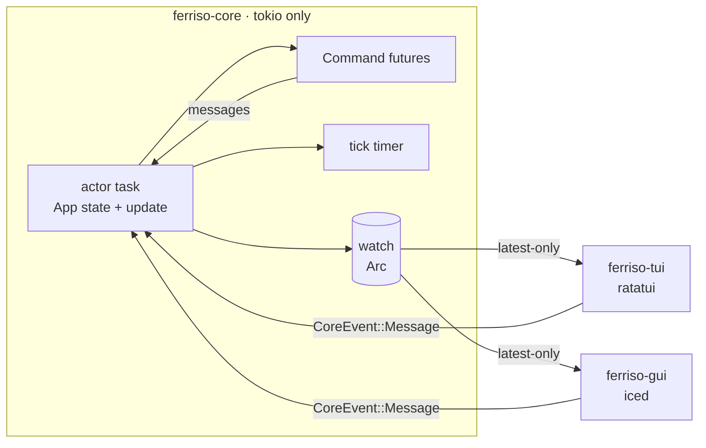

# Ferriso

One actor-owned application, two native frontends: **ratatui** in the terminal
and **iced** on the desktop, with **Tokio** as the runtime underneath.



The core is the only owner of domain state. A frontend receives immutable view
snapshots and sends semantic messages; it never calls `update`, never borrows the
application, and never shares a widget tree with the other frontend.

## Crates

| Crate | Role | Dependencies |
| --- | --- | --- |
| `ferriso-core` | Actor runtime, `App` contract, `Command`, snapshot channel | Tokio only |
| `ferriso-tui` | Terminal loop, crossterm translation, ratatui layout | `ferriso-core`, ratatui, crossterm, Tokio runtime |
| `ferriso-gui` | Iced adapter: snapshot-driven `State`, subscriptions, window | `ferriso-core`, iced, futures |
| `apps/player` | Practice app: one model + view model, two independent views | all three |

`cargo tree -p ferriso-core --edges normal` prints exactly one direct dependency:
Tokio. That is the dependency boundary, not a convention.

## Core contract

```rust
pub trait App: Send + 'static {
    type Message: Send + 'static;
    type View: Send + Sync + 'static;

    fn init(&mut self) -> Command<Self::Message> { Command::none() }
    fn update(&mut self, message: Self::Message) -> Command<Self::Message>;
    fn view(&self) -> Self::View;

    fn tick_interval(&self) -> Option<Duration> { None }
    fn tick(&mut self) -> Command<Self::Message> { Command::none() }
    fn should_quit(&self) -> bool { false }
    fn shutdown(&mut self) {}
}
```

Rules that keep the boundary real:

- `Message` is semantic. It contains no `crossterm::event::KeyEvent`, no
  `iced::keyboard::Event`, no widget or layout type. Each frontend maps raw input
  onto the application's messages.
- `View` is data, not a widget tree. The terminal and the window are free to lay
  out the same data differently.
- Commands are futures executed on the actor's Tokio runtime. Their results come
  back as ordinary messages, so all mutation still happens in one task.
- The timer belongs to the actor. Frontends do not tick the application.
- Snapshots are delivered over a `tokio::sync::watch` channel. A slow frontend
  gets the newest state instead of a backlog.

## Running a frontend

```rust
// Convenience: the adapter owns a private runtime, actor, and terminal/window.
ferriso_tui::run(Player::new(), PlayerTui::new(), Options::default())?;
ferriso_gui::run(Player::new(), PlayerGui::new(), Settings::default())?;

// When construction needs a reactor (HTTP clients, audio devices, tokio::spawn),
// build the app inside the adapter's runtime instead.
ferriso_gui::run_with_app(
    || Player::new(),
    PlayerGui::new(),
    Settings::default(),
)?;
```

One actor can serve several frontends:

```rust
let (handle, snapshots, task) = ferriso_core::spawn(Player::new());

let tui = std::thread::spawn({
    let handle = handle.clone();
    let snapshots = snapshots.clone();
    move || ferriso_tui::run_with(handle, snapshots, PlayerTui::new(), Options::default())
});

ferriso_gui::run_with(handle.clone(), snapshots, PlayerGui::new(), Settings::default())?;
handle.shutdown();
```

`run` (not `run_with`) is the single-frontend convenience: it shuts the actor
down and joins it when the UI exits. `run_with` deliberately leaves lifecycle
ownership with the caller.

## What iced owns, and what it does not

Iced owns its window, renderer, widget tree, focus, text cursor, scrolling, and
redraw scheduling. Those are frontend-local state and are not part of the
application model. Renderer-local messages (a seek preview, a key chord that
needs local state) travel through `Message::Local` and never wake the actor;
`on_snapshot` and `on_message` are the hooks for cover caches, QR codes, and
notifications, and `theme` lets each snapshot choose the window palette.

Iced **does not** own the application:

```text
boot:      Frontend { view: Arc<View>, handle: CoreHandle<Message>, renderer }
update:    User(message)   -> handle.send(message)   // no App::update here
           Snapshot(view)  -> replace the Arc        // read-only projection
           Closed          -> close the window
view:      renderer.view(&frontend.view)             // native iced layout
```

There is no `Mutex<App>` in the iced state. Recreating a window resumes from the
latest snapshot; it cannot fork the domain state. The subscription turns the
watch receiver into a stream, so iced receives changes without polling.

The same inversion holds for ratatui: the adapter owns the blocking loop, reads
the latest snapshot before drawing, and translates terminal events into
messages. It redraws only after an input event or a snapshot change, so an idle
terminal is not repainted twenty times a second. `Renderer::draw` receives `&View`; there is no mutable access to the
application.

## Why there is no shared layout IR in v1

The first prototype used a shared semantic widget tree (`Node` with `Row`,
`Column`, `Length`, padding, and callbacks) rendered by both backends. It worked,
but it forced one layout model onto two very different UI toolkits and made the
core know about presentation. It is preserved on the `node-ir-prototype` branch
for comparison, not used here.

This version deliberately stops at the **view data model**. Terminal and iced
views are written twice, with native layout, because that is the honest cost of
native UI. Once boxpigma and Modrinth (two real applications) both run on this
contract, duplicated *semantic components* can be extracted with evidence. A
shared layout engine before that would be speculative abstraction.

## Snapshot and event semantics

- Events are unbounded and cheap; messages are small and semantic.
- Snapshots are `Arc<View>`; handing one to a frontend is a refcount bump.
- `watch` coalesces updates: if ten commands finish before a frame, the frontend
  sees the final state.
- A command that finishes after shutdown simply fails to send and is dropped.
- Dropping every `CoreHandle` stops the actor. The TUI notices the closed
  snapshot channel and exits; iced receives `Closed` and closes the window.

## The practice app

`apps/player` exercises the contract with a music-player shell: sidebar
navigation, search, lists, lyrics, QR login (simulated), player controls,
progress, volume, and a spectrum.

```bash
cargo run -p ferriso-player --bin ferriso-player-tui
cargo run -p ferriso-player --bin ferriso-player-gui
```

Terminal keys: `Enter` play, `Tab` change focus, `Ctrl+Space` play/pause,
`Ctrl+←/→` previous/next, `Ctrl+M` mode, `Ctrl+L` like, `[`/`]` seek, `Ctrl+Q`
quit. In the window, the same state is driven by native buttons, sliders, and a
text input; `Ctrl+Space`, `Ctrl+←/→`, `Ctrl+M`, `Ctrl+L`, and `Ctrl+Q` are mapped
by the iced subscription.

The simulation never connects to a network or plays audio. Commands use
`tokio::time::sleep` to make asynchronous loading visible.

## Tests

```bash
cargo test --workspace
cargo clippy --workspace --all-targets
```

- `ferriso-core`: command round trips, actor ticks, shutdown when handles drop.
- `apps/player`: update/tick transitions, login as snapshot state, TUI rendering
  into a `TestBackend`, and terminal input translation (Enter, Tab, search
  editing).

The GUI is exercised by running the binary; it has no headless widget assertions
because iced's native renderer is the surface being tested.
